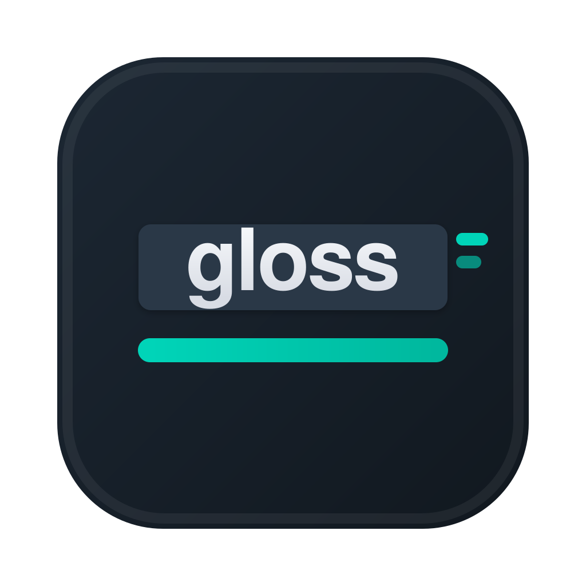
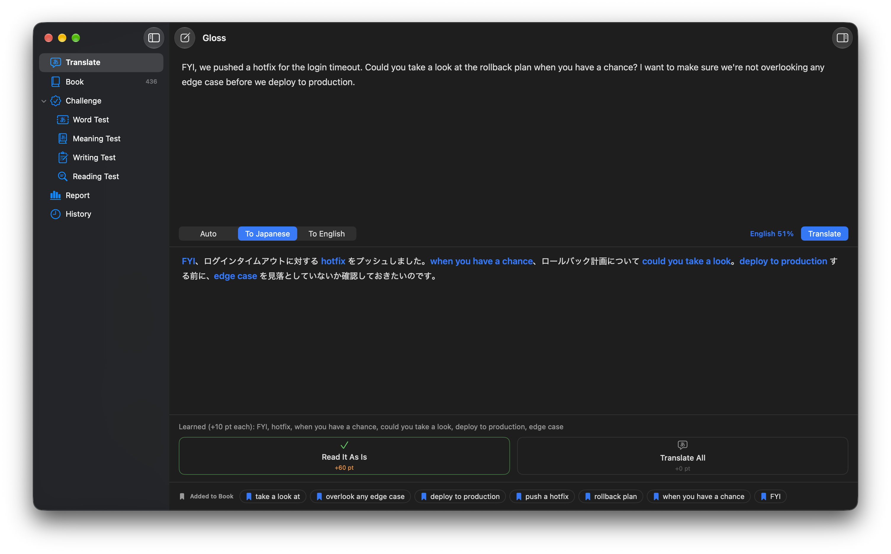
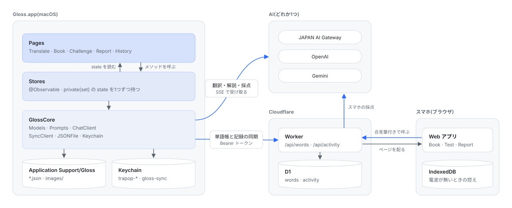

<div align="center">



# Gloss

**使うほど、訳が減っていく。**

仕事の英語を訳しながら覚えて、いつか訳なしで読めるようになるための macOS アプリ。

macOS 14+ · Swift 6 · Cloudflare Workers + D1 · スマホは PWA



</div>

## 覚えた語は、英語のまま訳に残る

英文を貼ると日本語に訳す。ただし Book で ✓ を付けた語だけは、訳の中に英語のまま残す。

> **FYI**、ログインタイムアウトに対する **hotfix** をプッシュしました。<br>
> **deploy to production** する前に、**edge case** を見落としていないか確認したいです。

✓ が増えるほど訳の中の英語が増えて、最後は原文のまま読めるようになる。
覚えた語が少ない英文では、AI がやさしい語を選んで残す。

| 選ぶもの | ポイント |
|---|---|
| **Read It As Is** — 英語が残ったまま読む | 覚えた語は1語 +10、やさしい語は1語 +5 |
| **Translate All** — 全部日本語にする | +0。急いでいるときは、いつでもこちら |

## 訳して、覚えて、試して、聞く

| | |
|---|---|
| **Translate** | 文章か画像を ⌘V で貼って訳す。覚える表現は AI が抜き出して Book に入れる。分からないところを選ぶと、右のパネルで解説が出る |
| **Book** | 集めた単語とフレーズのカード。押すと訳に入れ替わる。🔊 で単語と例文を読み上げ、**Listen** で全部を聞き流せる |
| **Challenge** | Word Test・Meaning Test・Writing Test・Reading Test。結果がそのまま Book の ✕ / ? / ✓ になる |
| **Report** | 今日やったこと、ポイント、訳の中の英語の割合の推移。画像にして Slack に貼れる |
| **スマホ** | Book・単語テスト・Report・読み上げ。Mac と同じデータを使う |

## 仕組み



- 単語帳と学習の記録は Cloudflare D1 が正。Mac とスマホは手元に控えを持ち、変えたら1秒後に送る
- Worker は、スマホ用のページを配ることと、合言葉付きの `/api/` を受けることの2つだけ
- 合言葉はスマホに QR コードで渡す。URL の `#` の後ろに入れるので、サーバーには届かない
- AI のキーは Mac の Keychain と Worker の secret にだけ置く。コードにも git にも入れない

> [!IMPORTANT]
> 合言葉が漏れたら `npx wrangler secret put SYNC_TOKEN` で入れ直し、Mac の設定とスマホにも入れ直す。古い合言葉はその時点で使えなくなる。

## はじめる

```sh
cd mac && ./scripts/install.sh       # ~/Applications/Gloss.app に入れる
```

1. **⌘,** で翻訳エンジン(JAPAN AI Gateway / OpenAI / Gemini)を選び、API キーを入れる
2. 同期するなら「Book Sync」に Worker の URL と合言葉を入れる
3. スマホは「Show QR Code」をカメラで読んで、ホーム画面に追加する

<details>
<summary>Cloudflare を用意する</summary>

```sh
cd cloud
npx wrangler d1 create gloss                               # 出た database_id を wrangler.jsonc に書く
npx wrangler d1 execute gloss --remote --file=schema.sql
npx wrangler secret put SYNC_TOKEN                         # 合言葉
npx wrangler secret put AI_KEY                             # スマホの採点に使う JAPAN AI のキー
npx wrangler secret put JAI_USER_ID
npx wrangler secret put AI_MODEL

cd ../web && npm install && npm test && npm run build      # Worker がこのビルドを配る
cd ../cloud && npx wrangler deploy
```

</details>

## ショートカット

| キー | 動き |
|---|---|
| ⌘V | 貼って訳す |
| ⌘↩ | 訳す / 採点 / 次の問題 |
| ⌘L | 選んだところを質問 |
| ⌘N | 新しい翻訳 |

## リポジトリ

```
mac/     Mac アプリ。Gloss(SwiftUI)と GlossCore(UI に依存しない部分。swift test)
web/     スマホ向けの PWA。Vite + React + TypeScript(npm test)
cloud/   Cloudflare Worker と D1 のスキーマ
docs/    図とスクショ
```
